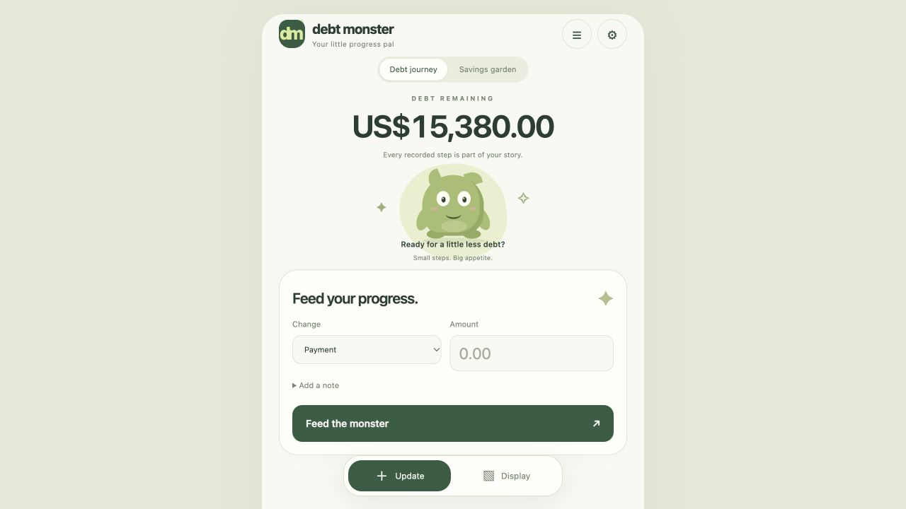
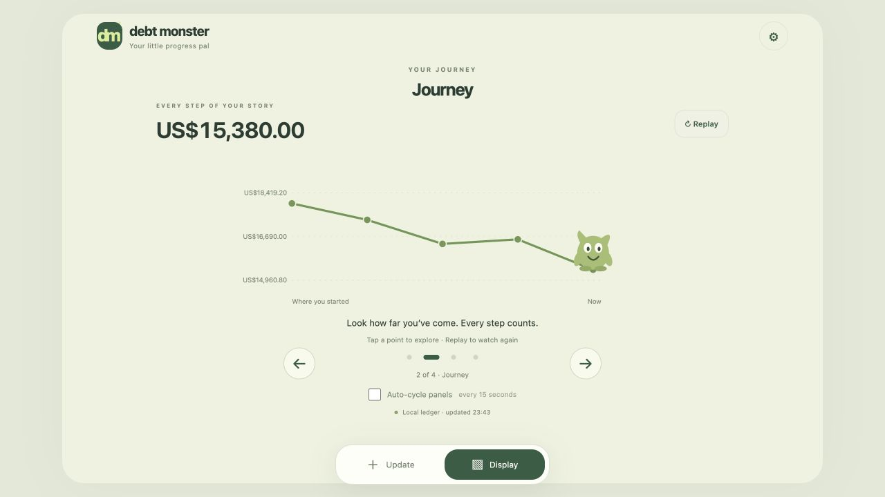
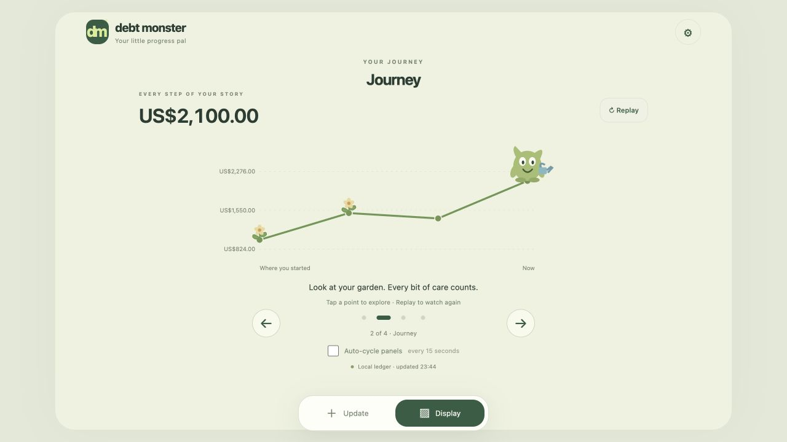

# Debt Monster

Debt Monster is a personal debt-payoff and savings tracker for your home. Record payments and charges, watch your balance change, and follow your progress with a friendly animated companion. When you are ready, switch to a separate savings garden without losing your debt history.

Use **Update** to enter changes and **Display** as a dashboard on a spare screen. Run it on your computer, or host it on a Raspberry Pi so everyone on your home network can use the same ledger. Data stays on the device running the server; no account, bank connection, or cloud service is required.

## A quick look

All screenshots below use artificial demo data.

**Record a change.** Enter an amount and optional note; use history to correct mistakes.



**Watch your journey.** Replay your balance history, inspect points, and switch between display panels manually or automatically.



**Grow your savings.** Track deposits and withdrawals with a garden that grows alongside your progress.



## Run on your computer

Requires Git and Python 3.11 or newer. After the application has been pushed to GitHub:

```sh
git clone https://github.com/archieLa/debt-monster.git
cd debt-monster
python3 -m venv .venv
.venv/bin/pip install -r requirements.txt
.venv/bin/python run.py
```

Open [Debt Monster](http://127.0.0.1:5050/). Enter your starting balance, or select **Try the demo**. Keep the terminal open while using the app; press Ctrl+C to stop it. Run `.venv/bin/python run.py` again to restart.

For a separate demo data folder, start with:

```sh
.venv/bin/python run.py --data-dir "$HOME/.local/share/debtmonster-demo"
```

## Record and view changes

- **Update:** choose Payment/Charge or Deposit/Withdrawal, enter an amount, optionally add a note, and press the submit button.
- **Recent activity:** use the history icon at the top to edit/delete entries or export CSV.
- **Display:** use the bottom tab, then arrows, dots, swipes, or Left/Right keys to move between panels. Enable **Auto-cycle panels** to advance every 15 seconds. On Journey, select points for details or press **Replay**.
- **Savings:** at payoff select **Start Saving**, or use **Settings → Switch active mode**. Enter a starting savings balance and optional goal. Use the Debt journey/Savings garden buttons to view retained history.
- **Settings:** change currency, download a backup, or restore one. Restore replaces current data after confirmation; later entries will be lost.

Enter amounts without thousands separators and with at most two decimal places. Transactions must be $0.01–$9,999,999,999.99. Starting balances may be zero. Debt overpayments appear as separate credit.

## Run on a Raspberry Pi

The Pi can host the app for every computer on your home network and show Display on an attached monitor at the same time.

Follow [Raspberry Pi setup](docs/raspberry-pi.md) for cloning from GitHub, automatic server startup, transferring your data, and an optional full-screen display at boot.

Once configured:

| Where | Address |
| --- | --- |
| Any computer on your home network | `http://debtmonster.local:5050/` |
| If the hostname does not resolve | `http://<PI-IP>:5050/` |
| Monitor attached to the Pi | `http://127.0.0.1:5050/display` |

Use the same home network rather than a guest Wi-Fi network. Everyone with access to the app can update the ledger. Do not forward port 5050 on your router or expose the app publicly.

## Data and backups

Data defaults to `~/.local/share/debtmonster` on the computer running the server. Use `--data-dir /path/to/folder` with `run.py`, or set `DEBT_MONSTER_DATA_DIR`, to choose another folder. Always restart with the same folder. The database and local settings are not part of the GitHub repository; cloning or pulling code does not transfer them.

Download JSON backups from **Settings → Download backup** and keep a copy on another device. To move from this computer to the Pi, download a backup here, open the Pi's site, and restore it there. After checking balances and history, make future entries through the Pi's address. The two installations do not sync.

Before updating: stop the server, copy its data folder, and record `git rev-parse HEAD`. Run `git pull --ff-only` from the repository folder, install requirements, and restart with the same data folder. Check balances/history before making new entries. If recovery is needed, stop the app and restore the previous code and compatible data backup. Never copy only a live SQLite database file; stop the server first or use SQLite's backup facility.

## Troubleshooting

- **Page does not open:** confirm the server is running. On the Pi, see the service/status commands in the setup guide.
- **Unexpected host:** add the exact hostname or Pi IP to `DEBT_MONSTER_ALLOWED_HOSTS`, then restart the server.
- **Other computers cannot connect:** check the Pi IP, shared network, router guest/client isolation, and any firewall blocking port 5050.
- **Changes are missing:** check the URL and data folder. Refresh older browser tabs after an app update.

## Project status

Debt tracking, the interactive display, savings, corrections, and backup/restore are implemented. Raspberry Pi setup files are included; physical Pi and household-network verification are still pending. See the [implementation checklist](debt_monster_product_spec.md) and [validation results](VALIDATION.md).
